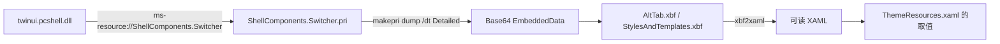
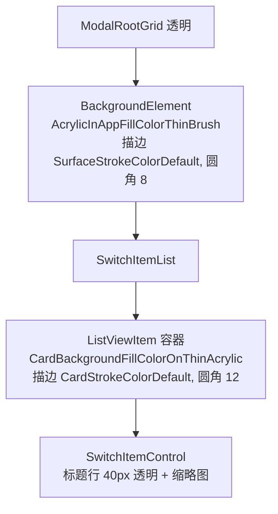

# 系统 Alt+Tab 视觉参数

基于 twinui.pcshell.dll 10.0.28000.2630 及其资源包，2026-10-16 提取。

## 概念

- **twinui.pcshell.dll**：explorer 内承载任务切换（Alt+Tab、任务视图、贴靠助手）的模块，`XamlAltTabViewController` / `AltTabViewHost` 都在这里。DLL 本身不含 XAML，只引用资源包。
- **PRI 资源包**：MRT 资源索引文件，XAML 编译产物（XBF）以 base64 的 `EmbeddedData` 候选嵌在里面。
- **XBF v2**：XAML 二进制格式，颜色、数值以类型化二进制存储，必须反编译才能读到具体取值。
- **luminosity 配方**：19H1 起 `AcrylicBrush` 的合成方式：背景模糊 → 与 luminosity 色做 Luminosity 混合 → 与 tint 色做 Color 混合 → 叠噪点。设置了 `TintLuminosityOpacity` 时，luminosity 色就是 tint 色按该不透明度直接取用。

## 架构

Alt+Tab 的视觉树只有三层：一个居中的 `Border`（面板），里面是 `SwitchItemList`，每项是 `ListViewItem` 容器（卡片底和描边）包着 `SwitchItemControl`（40px 标题行 + 缩略图）。

## 分点解释

### 资源位置与提取

资源包位于 [ShellComponents.Switcher.pri](C:/Windows/SystemResources/ShellComponents.Switcher/ShellComponents.Switcher.pri)，在 twinui.pcshell.dll 里只以 `ShellComponents` 等资源 URI 出现，所以直接对 DLL 搜 `.xbf` 什么都找不到。提取步骤：用 Windows SDK 的 `makepri.exe dump /dt Detailed` 导出 XML，把每个 `NamedResource` 下的 `Base64Value` 解码成 `.xbf`，再用开源的 [XbfAnalyzer](https://github.com/chausner/XbfAnalyzer) 中的 `xbf2xaml` 反编译。Alt+Tab 相关的是 `AltTab.xbf`（布局）和 `StylesAndTemplates.xbf`（主题字典与样式）。

### 面板材质

`AltTab.xbf` 的面板 `Background="{ThemeResource AcrylicInAppFillColorThinBrush}"`，该画刷在 `StylesAndTemplates.xbf` 的主题字典里定义：

| 主题 | TintColor | TintOpacity | TintLuminosityOpacity | FallbackColor |
|------|-----------|-------------|-----------------------|---------------|
| Dark | `#545454` | 0 | 0.64 | `#202020` |
| Light | `#D3D3D3` | 0 | 0.44 | `#F3F3F3` |

tint 层不透明度为 0，压暗或提亮全靠 luminosity 层。模糊量与噪点没有显式设置，取 `AcrylicBrush` 的默认值 30 与 0.02。系统用的是 `BackgroundSource="Backdrop"`，因为它的 XAML 直接合成在 explorer 的视觉树里；我们的 island 看不到身后的桌面，只能用 HostBackdrop。实测两者在同一张壁纸上的面板采样颜色相差 1 到 6 个色阶。

我们在 [MainView.cpp](/gui/ui/switcher/MainView.cpp) 的 `UpdateContainerAcrylicBrush` 里用 Win32Acrylic 的 `AcrylicMaterial::Acrylic`（与 XAML `AcrylicBrush` 同一套 luminosity 配方）复现，参数从 [ThemeResources.xaml](/gui/xaml/ThemeResources.xaml) 的 `Acrylic*` 键读取。Legacy 配方（exclusion 混合 + 饱和度）与系统不同，不再使用。

### 描边与圆角

面板样式 `AltTabModalBackgroundStyle` 的描边是 `SurfaceStrokeColorDefaultBrush`，两种主题都是 `#66757575`，1px，圆角 `OverlayCornerRadius` 为 8。半透明中灰在深浅背景上都只是一条淡线；不能用白色系描边，否则暗色下会显得发白。

### 卡片

卡片的底和描边画在 `ListViewItem` 容器模板的 `BackgroundBorder` 上，`SwitchItemControl` 本身不铺底：

| 主题 | 卡片底 `CardBackgroundFillColorOnThinAcrylic` | 描边 `CardStrokeColorDefault` |
|------|------|------|
| Dark | `#A6000000` | `#19000000` |
| Light | `#E6F6F6F6` | `#0F000000` |

容器圆角 12，描边 1px。标题行固定 40px、透明，标题文字用 `TextFillColorPrimaryBrush`，图标左右边距 12/8，关闭按钮占 40px 列且只在悬停时显示；缩略图区也不铺底。对应到 [SwitcherItem.xaml](/gui/xaml/SwitcherItem.xaml)：`MainCard` 承担底色、描边和圆角，`TitleBorder` 与 `ContentFrame` 保持透明；标题行固定 40 DIP，关闭按钮占 40 DIP 宽。布局在像素空间计算，[LayoutEngine.cpp](/gui/ui/switcher/LayoutEngine.cpp) 把标题行和描边按当前 DPI 换算后加在缩略图区外侧，所以缩放比例变化时标题行的视觉高度不变，缩略图区仍保持窗口宽高比。
