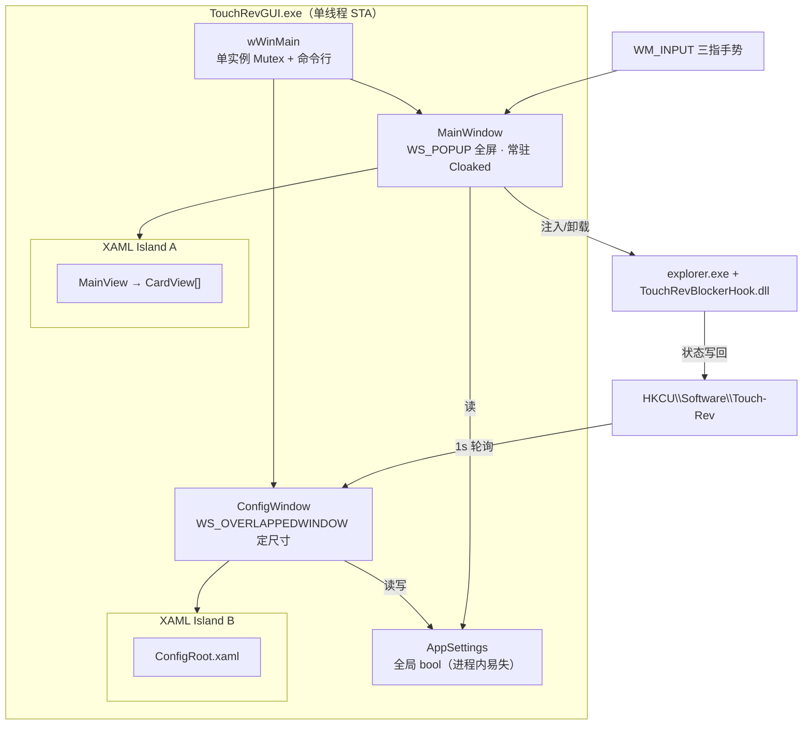
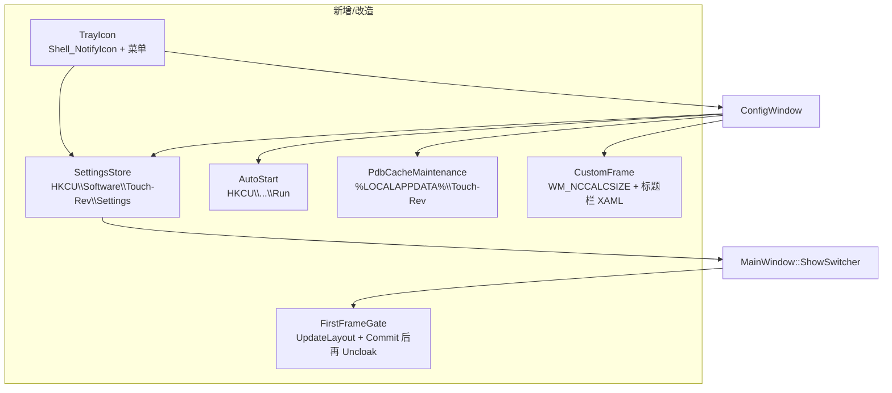
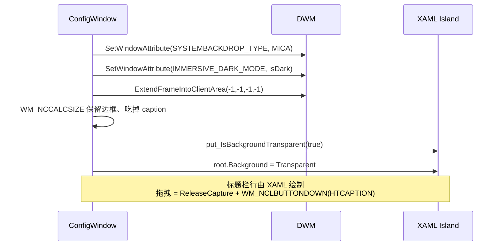
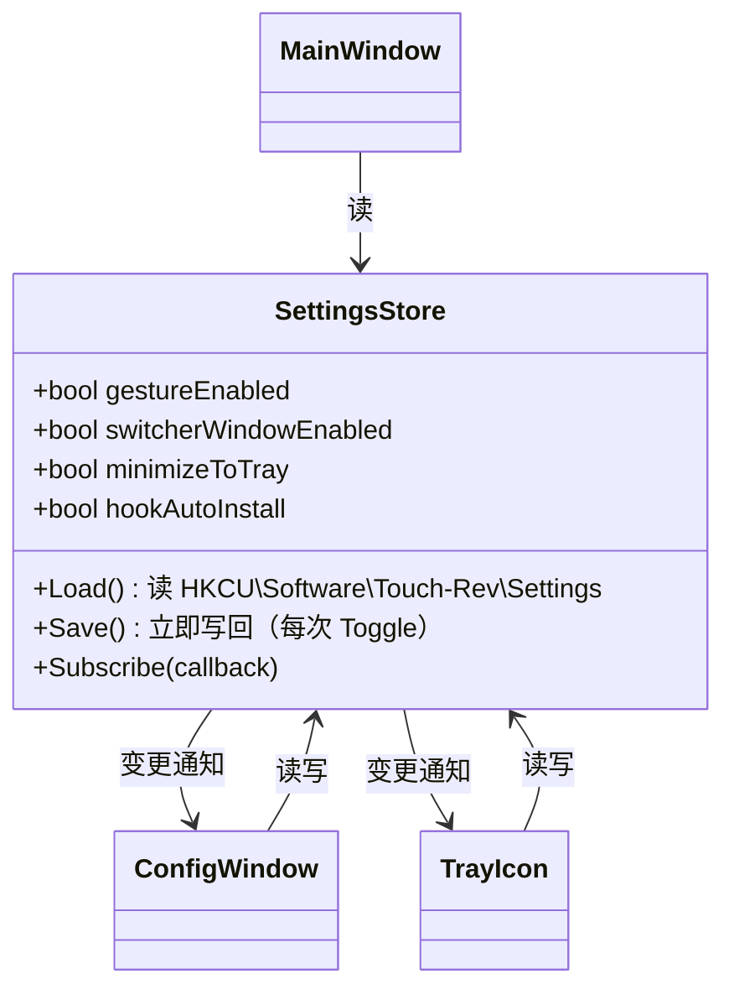
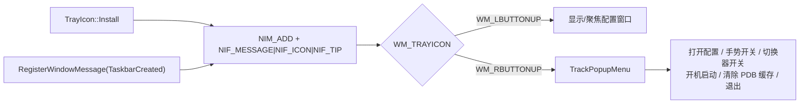
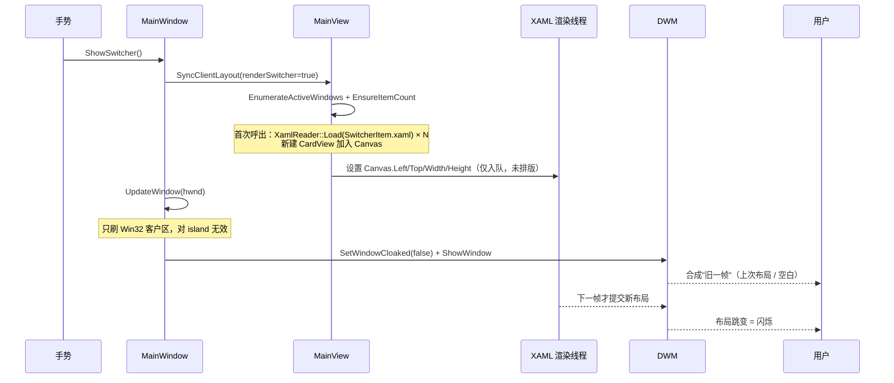

# 管理端现代化与呼出体验优化

## 概念

- **Mica**：Windows 11 的窗口背板材质，由 DWM 在窗口背后绘制（取样桌面壁纸做超模糊），通过 `DwmSetWindowAttribute(DWMWA_SYSTEMBACKDROP_TYPE, DWMSBT_MAINWINDOW)` 开启。生效前提是窗口客户区**没有不透明内容遮挡**。
- **沉浸式标题栏**：应用把客户区扩展到原本的标题栏区域（`WM_NCCALCSIZE` 去掉 caption 高度），自己绘制标题与按钮，使标题栏与内容共享同一张 Mica 背板。
- **XAML Island**：`DesktopWindowXamlSource` 在 Win32 HWND 内托管一棵 WUX 视觉树，产生一个子 HWND。子 HWND 默认带不透明重定向位面，需要私有接口 `IXamlSourceTransparency` 打开透明后，Mica 才能透上来。
- **DWM Cloak**：`DWMWA_CLOAK` 让窗口保持 `WS_VISIBLE`（XAML 继续排版、渲染、跑动画）但不参与桌面合成。AppSwitcher 用它做"隐藏"，避免每次呼出重建 XAML 树。
- **PDB 缓存**：Blocker 的 hook 需要 `twinui.pcshell.pdb` 来定位手势表 data symbol，dbghelp 以 `srv*%LOCALAPPDATA%\Touch-Rev*msdl` 形式下载并缓存。缓存损坏/identity 不匹配时拦截会失效。

## 架构

当前进程只有一个 UI 线程、一个消息循环（`MainWindow::Run`），两个顶层窗口各自持有一个 XAML Island，配置状态是一组**没有持久化**的全局变量。

改造后引入三个新单元，并把易失的全局配置换成注册表托底的 `SettingsStore`：

## 分点解释

### 一、配置窗口：白底不透明 → Mica + 沉浸式标题栏

**现状的三处硬伤**（`ConfigWindow.cpp` / `ConfigRoot.xaml`）：

1. `ConfigRoot.xaml` 根 Grid 写死 `Background="{ThemeResource SolidBackgroundFillColorBaseBrush}"`，而该键在 `ThemeResources.xaml` 里是 `#FF101010` / `#FFF3F3F3` **全不透明**。`OnCreate` 里虽然已经调了 `DWMWA_SYSTEMBACKDROP_TYPE = 2`（Mica）和 `DwmExtendFrameIntoClientArea(-1)`，但整块客户区被这层纯色盖住，Mica 一个像素都露不出来。
2. ConfigWindow 的 XAML Island 没有走 `IXamlSourceTransparency::put_IsBackgroundTransparent(true)`——AppSwitcher 那条链路（`ThinXamlAppSwitcherHost::Initialize`）做了，配置窗口这条独立链路漏了。即使把根背景改成 `Transparent`，island 自身的重定向位面仍是不透明的。注意该接口作用在**线程共享的** `Window::Current` 上，因此谁先初始化谁生效；不能依赖初始化顺序，必须显式设置。
3. 标题栏仍是系统 caption：标题文字用系统字号、图标是 `IDI_APPLICATION`，与下方内容是两张割裂的面板。

**改造路径**：

- `WM_NCCALCSIZE`：`wParam == TRUE` 时先 `DefWindowProc` 拿到系统建议的客户区，再把 `rgrc[0].top` 抬回窗口顶边（保留左右下边框以维持阴影与调整手感）。窗口最大化时需额外补 `SM_CYFRAME + SM_CXPADDEDBORDER`，本窗口固定尺寸不可最大化，可略。
- **标题栏行**：XAML 里一行 48px（DIP），左侧应用图标 + "Touch-Rev 控制中心"（`FontSize=12`，与系统 caption 对齐），右侧自绘最小化/关闭按钮（46×32，hover `SubtleFillColorSecondary`，关闭 hover 走 `#C42B1C`）。因为 island 会吞掉所有命中测试，系统 caption 的拖拽/双击行为必须在 XAML 侧转发：`PointerPressed → ReleaseCapture(); SendMessage(hwnd, WM_NCLBUTTONDOWN, HTCAPTION, 0)`。
- **背景分层**：根透明后，卡片不能再用 `#EE242424` 这种近乎不透明的值，否则整页又回到"贴了张纸"的观感。改用 WinUI 的 Mica-on-card 层级：卡片 `CardBackgroundFillColorDefault`（暗 `#0DFFFFFF` / 亮 `#B3FFFFFF`），分组标题不带背板，状态 banner 用 `AccentFillColorSecondary` 淡染。
- **主题切换**：`ThemeManager::ApplyWindowBackdrop` 目前对 `isDialog_` 分支提前 `return`，不设背板类型，Mica 是 ConfigWindow 自己在 `OnCreate` 里另写的一段——职责重复。应把背板类型收进 `ThemeManager`，按窗口角色取 `DWMSBT_NONE`（AppSwitcher，自己画亚克力）或 `DWMSBT_MAINWINDOW`（配置窗口），暗色切换时连带刷新自绘标题栏按钮的前景色。

**布局重排**：现在是三张同构卡片平铺 + 底部一行退出链接，信息层级扁平。改为 WinUI Settings 式分组：

| 分组 | 条目 |
|------|------|
| 状态 | 运行状态 banner（呼吸灯 + PDB/Hook 文案，沿用现有状态机） |
| 手势 | 系统手势 Hook 拦截、自定义手势识别、任务切换卡片窗口 |
| 应用 | 开机自动启动、关闭时最小化到托盘 |
| 维护 | PDB 符号缓存（显示占用体积 + 清除按钮）、打开日志/缓存目录 |
| 关于 | 版本、退出应用 |

### 二、应用管理：托盘、开机启动、缓存维护

**配置持久化是前提**。`core/common/AppSettings.h` 目前是两个 `inline bool` 全局量，进程退出即丢；开机启动一旦打开，用户的手势开关状态却每次都回到默认值，体验是断裂的。改造成 `SettingsStore`：

键值放 `HKCU\Software\Touch-Rev\Settings`，与 Blocker 写状态的 `HKCU\Software\Touch-Rev` 同根但分子键，避免和 `PdbStatus`/`HookStatus` 这些运行时量混在一起。变更即写（条目很少，无需节流），并通过回调让托盘菜单勾选态与配置窗口开关保持一致——这是当前两处 UI 会不同步的唯一风险点。

**托盘图标**：`Shell_NotifyIconW` 必须挂在一个生命周期覆盖整个进程的窗口上。AppSwitcher 的 `MainWindow` 是 `WS_EX_TOOLWINDOW` 全屏 popup，把托盘回调消息塞进去会和手势消息处理混杂；更干净的做法是建一个专用的隐藏宿主窗口（`TouchRevGUI.TrayWindow`），只处理 `WM_TRAYICON` 与 `TaskbarCreated`（explorer 重启后必须重新 `NIM_ADD`，否则图标永久消失——这是托盘实现最常见的漏项）。

菜单弹出前需 `SetForegroundWindow(trayHwnd)`，弹出后补一条 `PostMessage(trayHwnd, WM_NULL, 0, 0)`，否则菜单在失焦时不会消失（Win32 经典缺陷）。图标资源当前完全缺失（`TouchRevGUI.rc` 里只有 manifest），需要新增 `.ico`（16/20/24/32/48/256）并加入 rc，顺带把窗口类的 `hIcon` 从 `IDI_APPLICATION` 换过来。

**开机启动**：非打包应用只能走 `HKCU\Software\Microsoft\Windows\CurrentVersion\Run`，值写 `"<exe 全路径>" --hide`（`--hide` 分支已经存在于 `main.cpp`，开机时静默驻留、只留托盘）。读取状态时要一并检查 `HKCU\...\Explorer\StartupApproved\Run` 下同名值——用户在任务管理器"启动"页禁用后，Run 键仍在但实际不生效，只看 Run 键会显示错误的开关状态。写入时若该值存在且首字节表示"已禁用"，应把它删掉以真正恢复自启。

**PDB 缓存清除**：缓存根目录 `%LOCALAPPDATA%\Touch-Rev`（`dbghelp_symbol_provider.cpp: BuildSymbolCacheRoot`），内部按 `<pdb 名>\<GUID+Age>\<pdb 文件>` 分层。清除要处理三件事：

1. **占用**：hook 已注入时，explorer 内的 dbghelp 会话可能仍持有 PDB 句柄，删除会 `ERROR_SHARING_VIOLATION`。UI 上应先检测 hook 状态，提示"需要先关闭拦截"，而不是删一半留下一堆残骸。
2. **原子性**：逐文件删除失败时要把已删/未删数量报回来；简单可靠的做法是先 `MoveFileEx` 到同盘的临时名再递归删，失败则标记 `MOVEFILE_DELAY_UNTIL_REBOOT`。
3. **反馈**：清除前显示当前缓存体积（递归 `GetFileSizeEx` 求和），清除后刷新为 0，并把 `HKCU\Software\Touch-Rev` 下的 `PdbStatus/PdbSource` 复位，让状态 banner 立刻反映"下次启用时将重新下载"。

### 三、AppSwitcher 首帧重排闪烁

**现象**：三指手势触发后，切换器出现的第一瞬间能看到卡片位置/尺寸跳一次。

**成因**在 `MainWindow::ShowSwitcher` 的时序里：

三个叠加因素：

- **异步排版**：设置 `Canvas.SetLeft`、`Width` 等只是标脏，真正的 measure/arrange 在下一个 XAML 布局周期。`UpdateWindow` 刷的是宿主 HWND 的 `WM_PAINT`，和 island 的合成树毫无关系，起不到"确保首帧完成绘制"的作用（注释与实际行为不符）。
- **首次呼出的冷启动成本**：`EnsureItemCount` 在第一次真正呼出时才批量 `XamlReader::Load` 卡片模板并注册 DWM 缩略图，这一批工作足够跨越好几帧。
- **重复应用主题**：`ShowSwitcher` 里 `RefreshTheme()` 与紧随其后的 `ApplyTheme(...)` 会再标脏一次视觉树，把稳定帧又往后推。

**修复三步**：

1. **同步排版**：`ApplyLayout` 结束后对 XAML 根调 `UpdateLayout()`，强制在当前调用栈内完成 measure/arrange，消除"属性已设、布局未跑"的窗口期。
2. **提交后再揭示**：把 `SetWindowCloaked(false)` 从同步路径挪到合成提交完成之后——优先用 `Compositor::RequestCommitAsync()` 的完成回调，不可用时退化为监听 `CompositionTarget::Rendering` 跳过两帧再揭示。代价是 16–32ms 的呼出延迟，换取零闪烁；因为窗口一直是 cloaked 而非 hidden，这段时间 XAML 照常渲染，不会额外拖慢。
3. **预热**：进程启动后在空闲时（`WM_APP` 自投递或首个 timer tick）做一次离屏 `RenderSample`，把卡片池、`SwitcherItem.xaml` 解析、缩略图管理器全部建好，让首次呼出和后续呼出走同一条热路径。同时把 `ShowSwitcher` 里重复的 `RefreshTheme` + `ApplyTheme` 合并成一次。
