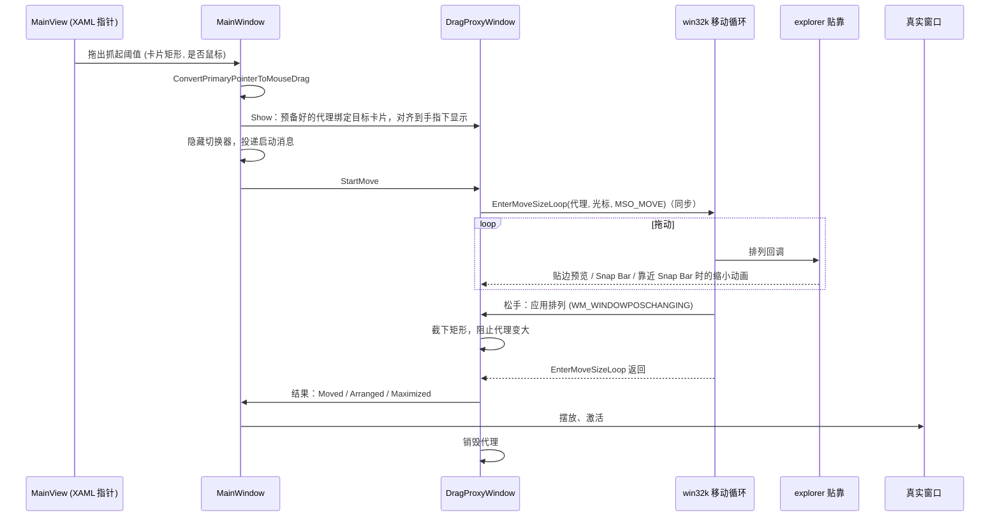
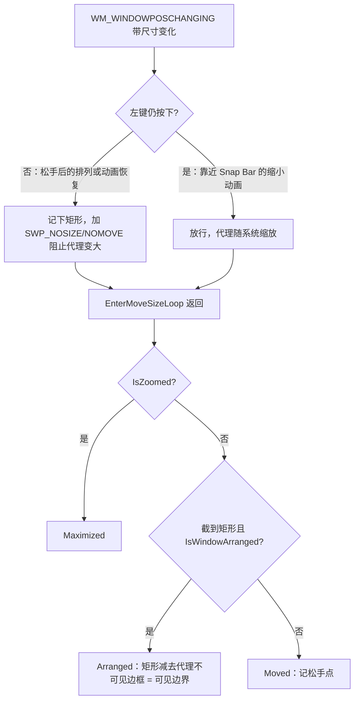
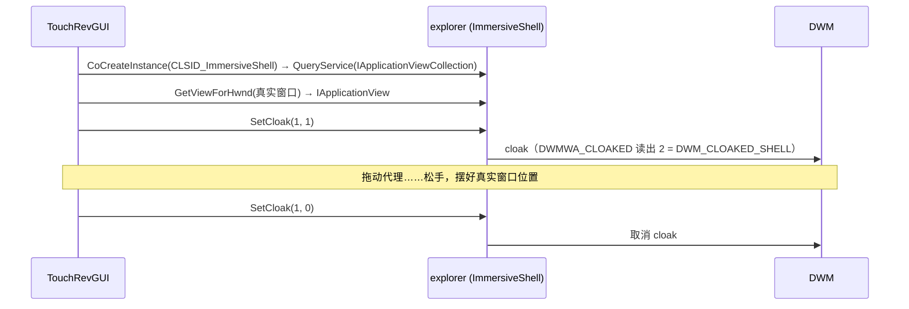

# 卡片拖拽接入系统贴靠

基于 Windows 11 build 28120（twinui.pcshell.dll 10.0.28000.2630、SDK 10.0.28000.0）的调查与实测，2026-10-16。

## 概念

- **移动循环（move-size loop）**：拖动标题栏时，窗口所属线程进入的模态循环，由 win32k 跟踪鼠标、移动窗口，前后发出 `WM_ENTERSIZEMOVE` / `WM_EXITSIZEMOVE`。
- **窗口排列（window arrangement）**：贴边吸附、最大化、贴靠布局等"被系统摆放"状态的统称。win32k 在移动循环中通过排列回调把拖拽进度交给 explorer，由 explorer 画贴边预览和 Snap Bar，松手后把排列应用回窗口。
- **Snap Bar**：拖到屏幕顶部时弹出的布局模板条；**贴边预览**：拖到边缘时的半透明目标框；**Snap Assist**：贴靠后在剩余区域列出其他窗口供选择。
- **主指针转鼠标拖拽**：`ConvertPrimaryPointerToMouseDrag` 把正在进行的触摸/笔接触转成鼠标左键拖拽。移动循环只认鼠标，触摸要先转换。
- **代理窗口**：我们自己创建的卡片大小的顶层窗口，由它进入移动循环来获得系统贴靠交互，结束后把结果搬到真实窗口上。

## 架构

贴靠交互只在"某个窗口处于系统移动循环中"时出现，而移动循环必须在窗口所属线程里跑，我们无法让别的进程的窗口可靠地进入循环。因此由与切换器同线程的代理窗口进入循环，真实窗口只在松手后被摆放一次。



## 分点解释

### 系统侧的实现

- [twinui.pcshell.dll](C:/Windows/System32/twinui.pcshell.dll) 的 PDB 中有 `WindowDragInputProvider`（`OnWindowArrangementMessage`、`HitTestControl`、`EndWindowDrag`）和 `SnapFlyoutHost::ShowSnapBar`、`CShellSnapComponent::OnMoveSizeAttempted`：explorer 接收拖拽进度、做 Snap Bar 命中测试并显示浮层。
- [win32u.dll](C:/Windows/System32/win32u.dll) 导出 `NtUserRegisterWindowArrangementCallout`、`NtUserSetWindowArrangement`、`NtUserEnterMoveSizeLoop`、`NtUserConvertPrimaryPointerToMouseDrag`。

没有"不移动任何窗口、只显示贴靠浮层"的入口，所以一定要有一个窗口进入移动循环。

### 公开 API

SDK 10.0.28000.0 的 WinUser.h（`NTDDI_WIN11_GE`，Win11 24H2 起）声明、user32 按名称导出，在线文档查不到，代码里用 `GetProcAddress` 动态获取，旧系统退回原有的切换器内拖动：

```cpp
BOOL WINAPI ConvertPrimaryPointerToMouseDrag(VOID);
BOOL WINAPI EnterMoveSizeLoop(HWND hwnd, POINT ptCursor, MOVESIZE_OPERATION moveSizeCode); // MSO_MOVE = 9
```

实测行为：

- `ConvertPrimaryPointerToMouseDrag` 要在指针仍被本线程持有时（XAML 指针回调里）调用，之后系统的异步左键状态变为按下。
- `EnterMoveSizeLoop` 对其他进程的窗口返回 `E_ACCESSDENIED`，只能用于本线程窗口。
- `EnterMoveSizeLoop` 是同步的：松手、系统应用完排列后才返回，返回时结果已齐全，不需要等待。

### 为什么不让真实窗口自己进入循环

给真实窗口投递 `WM_SYSCOMMAND SC_MOVE|HTCAPTION`、并用 `AttachThreadInput` 合并输入状态（移动循环按目标线程自己的按键状态判断左键），可以让真实窗口进入移动循环，但实测问题太多：Chromium 系窗口（Chrome、QQ）连续拖动时隔次无法进入循环；最小化窗口要先还原才能拖，延迟明显；大窗口按原尺寸出现在手指下，遮住大半屏幕；提权窗口的合并输入、投递消息、`SetWindowPos` 全被 UIPI 拒绝。代理方案不经过目标线程，这些问题都不存在。

### 代理窗口

实现在 [DragProxyWindow.cpp](/gui/ui/switcher/DragProxyWindow.cpp)，由 [MainWindow.cpp](/gui/ui/switcher/MainWindow.cpp) 的 `HandOffDragToProxy` / `StartPendingWindowDrag` / `ApplyDragProxyResult` 驱动；卡片矩形来自 [MainView.cpp](/gui/ui/switcher/MainView.cpp) 的 `TryHandOffDrag`，在抓起阈值处调用，此时卡片还停在布局位置，代理从原位"浮起"。

- **样式**：系统只对可调整大小、可最大化的窗口提供贴靠，代理用完整的 `WS_OVERLAPPEDWINDOW`，再用 `WM_NCCALCSIZE` 返回 0 去掉非客户区。创建时的首次 `WM_NCCALCSIZE` 不带 `wParam`，不会走去掉非客户区的分支，必须创建后补一次 `SWP_FRAMECHANGED`，否则顶部留一条 56 px 的非客户区并被画成 Win10 白色标题栏；`WM_NCPAINT` / `WM_NCACTIVATE` 也直接返回，防止激活切换时补画。`DWMWA_NCRENDERING_POLICY` 设为禁用，去掉 DWM 的边框、阴影和圆角。可调整大小的窗口默认有最小拖动尺寸 `SM_CXMINTRACK`（175% 下 264 px），按 100×100 创建的预备代理实测被撑成 264×100，因此 `WM_GETMINMAXINFO` 把最小尺寸放开到 1×1。已知问题：窄卡片拖动时系统画的模糊背景仍比卡片宽，放开最小尺寸后依旧存在，原因未查明。
- **内容**：代理以 `WS_EX_NOREDIRECTIONBITMAP` 创建，内部是第二个 XAML 岛（[ThinXamlAppSwitcherHost](/gui/ui/switcher/ThinXamlAppSwitcherHost.cpp)），放一个用 `SwitcherItem.xaml` 建的 `CardView`，外观与切换器里的卡片一致，圆角外是透明像素。缩略图由代理自己的 `PrivateThumbnailManager` 提供，最小化窗口也能显示，拖动期间不需要还原。靠近 Snap Bar 时系统缩小窗口，卡片用 `ScaleTransform` 等比缩放而不重新排版。
- **预备**：建窗口、XAML 岛和加载卡片模板要 15–47 ms，拖出时现场创建会让快速拖出的卡片落后于手指。代理在切换器预热时和每次拖动结束后空闲时预先建好（`Prepare`），拖出时只绑定目标、设尺寸位置、显示。代理每次用完即销毁（系统会在窗口上留下排列状态），所以每次都要重新预备。
- **对齐手指**：代理大小取卡片矩形，位置让"最初按在卡片上的点"落在当前指针下；显示到进入移动循环之间手指还会移动，`StartMove` 进入循环前再对齐一次，循环才以正确的相对位置跟手。
- **启动时机**：移动循环是模态的，不在 XAML 指针回调里进入，而是隐藏切换器后投递 `kStartWindowDragMessage`，在消息处理里以当前光标位置调用 `EnterMoveSizeLoop`。

### 截获排列结果

松手后系统通过 `WM_WINDOWPOSCHANGING` 把排列矩形应用到代理，发生在 `WM_EXITSIZEMOVE` 之前约 1 ms。



- 靠近 Snap Bar 时系统会让被拖窗口播缩小动画，松手不选格子时又会播恢复动画，这些尺寸变化不是排列结果。按左键状态区分动画与松手，最终是否贴靠以 `IsWindowArranged` 为准——阻止了代理变大之后，系统仍然把代理标记为已排列，它能可靠地区分"贴到半屏"和"只是从缩小动画恢复"。
- 代理与真实窗口都有 DWM 不可见缩放边框（代理实测为左右下各 10 px），结果统一换算成可见边界传递，摆放时由 `PlaceWindowVisibleRect` 按真实窗口自己的边框补回。

### 搬到真实窗口

`ApplyDragProxyResult` 先摆放真实窗口、再销毁代理，中间不留空档：Arranged → `PlaceWindowVisibleRect`（还原后按可见边界 `SetWindowPos`，再激活）；Maximized → 还原后 `SW_MAXIMIZE`；Moved → 沿用原有的 `ActivateWindow(hwnd, 松手点, 工作区)`，把窗口居中到松手点。实测摆放耗时 0–62 ms。

用 `SetWindowPos` 摆到贴靠矩形只是位置相同，系统不认为真实窗口处于贴靠状态：不会组成贴靠组，从贴靠位置拖出时不恢复原尺寸，Snap Assist 也是针对代理触发的。需要原生贴靠状态时，可以在结果为半屏、四分之一或最大化时激活目标后发 Win+方向键；Snap Bar 的三分屏等布局只能借助已注入 explorer 的 hook 调用其内部排列函数（最终走 `NtUserSetWindowArrangement`），需要逆向。

### 系统把代理识别成另一个应用

explorer 的贴靠组件按被拖窗口的 HWND 找到它的应用视图（`IApplicationView`，由窗口所属进程或 AppUserModelID 决定），据此显示图标、计算 Snap Bar 里的组合建议（`DesktopSnapLayoutManager::GetSnappableWindowSuggestions`）。代理是 TouchRevGUI 进程的窗口，系统看到的就是"TouchRevGUI 的一个窗口"：拖动中不显示目标应用的图标，而真实窗口仍作为另一个可见窗口留在原处，于是被 Snap Bar 当成可组合的候选。

复制图标、标题、AUMID 到代理不解决问题：它不改变"代理是另一个窗口"这一事实，组合建议仍包含真实窗口。

**拖动期间由 shell 隐藏真实窗口**（已实现，[WindowController.cpp](/gui/ui/switcher/WindowController.cpp) 的 `SetShellCloak`）：`DwmSetWindowAttribute(DWMWA_CLOAK)` 对其他进程的窗口返回 `E_ACCESSDENIED`，`ShowWindow(SW_HIDE)` / 最小化又会改动目标应用自身状态；但 explorer 有权 cloak 任意窗口（虚拟桌面即靠此实现），并经 immersive shell 的 COM 服务对外提供：



- 接口未公开：`IApplicationViewCollection {1841C6D7-4F9D-42C0-AF41-8747538F10E5}`、`IApplicationView {372E1D3B-38D3-42E4-A15B-8AB2B178F513}` 在注册表 `HKCR\Interface` 下登记了 proxy/stub，可跨进程调用；`SetCloak(APPLICATION_VIEW_CLOAK_TYPE, int)` 的签名取自 twinui.pcshell 符号，在 `IInspectable` 之后排第 7 个方法，实测 `GetThumbnailWindow` 返回窗口本身、`SetCloak(1, 1)` 后 DWM cloak 状态为 2，布局成立。IID 或方法顺序随系统版本变化时调用会失败，失败只记日志，拖动照常进行，只是真实窗口不隐藏。
- 时机：代理显示后立即 cloak，在进入移动循环之前，Snap Bar 计算组合建议时真实窗口已不可见；松手后先摆放真实窗口，再取消 cloak，窗口直接出现在新位置。拖动失败、程序退出时也会取消。
- 风险：TouchRevGUI 在拖动中途崩溃会留下一个被 shell 隐藏的窗口（切换器也会把它过滤掉），重启 explorer 可恢复。

图标仍是代理的：贴靠组件按被拖窗口查视图，代理属于 TouchRevGUI。要让图标、名称也按真实应用显示，只能由已注入 explorer 的 hook DLL 拦截贴靠组件对被拖窗口的视图查询、对代理返回真实窗口的视图，需逆向贴靠组件的调用链。

### 边界情况

- **提权窗口**：代理拖动正常，最后的 `SetWindowPos` 被 UIPI 拒绝，真实窗口不动，与改造前的行为一致。
- **旧系统**：缺 `ConvertPrimaryPointerToMouseDrag` 时触摸拖动不交接，由切换器内的原有拖动接管；缺 `EnterMoveSizeLoop` 时代理已显示、切换器已隐藏，`StartPendingWindowDrag` 销毁代理并把真实窗口激活到当前光标处。
- **鼠标拖动**：跳过转换，直接进入代理的移动循环。前提是进程**不能**开启 `EnableMouseInPointer`：它对整个进程生效且无法关闭，开启后真鼠标以 `WM_POINTER*` 送达，移动循环只在开头几十毫秒跟手，之后鼠标移动全被派发进代理的窗口过程（实测每 60 ms 三五十条），循环本身收不到，代理停在原地，直到松手才一步追到光标处。触摸经 `ConvertPrimaryPointerToMouseDrag` 转换出的拖拽不受影响，所以只有鼠标会卡。因此 [InputController.cpp](/core/input/InputController.cpp) 不再开启它，切换器的鼠标走传统 `WM_*BUTTON*` 消息。
