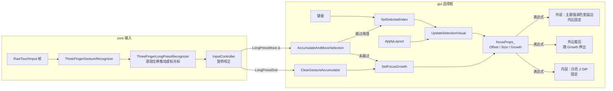
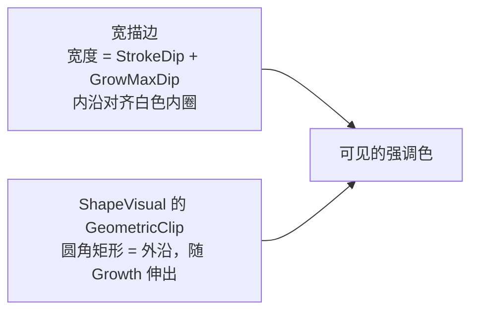
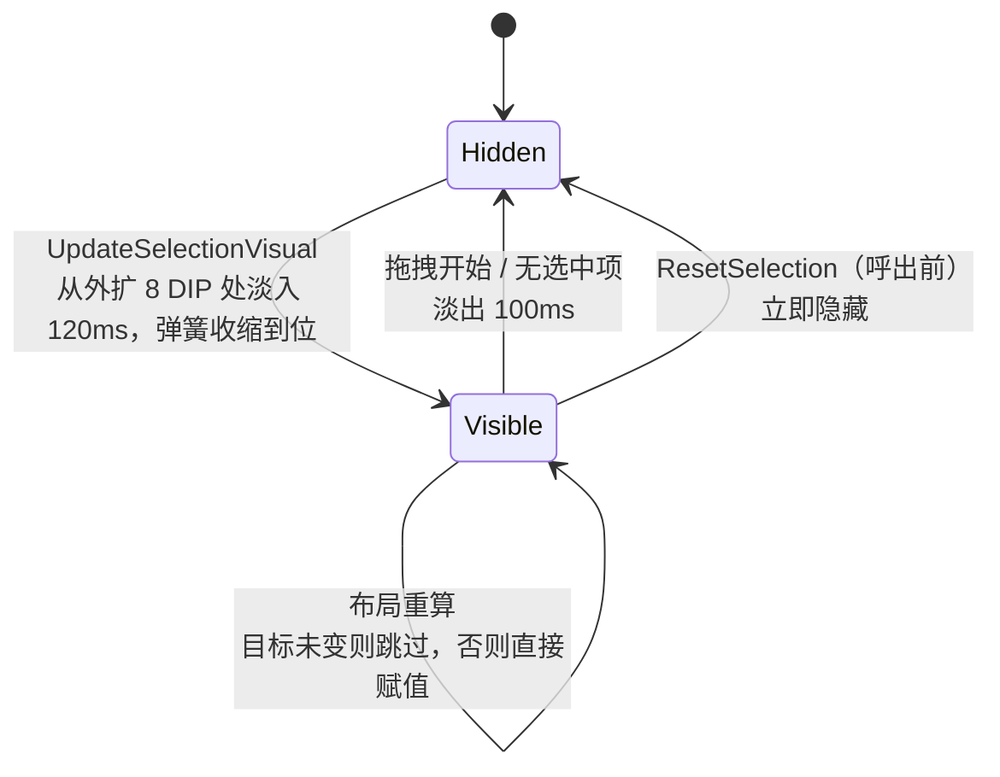
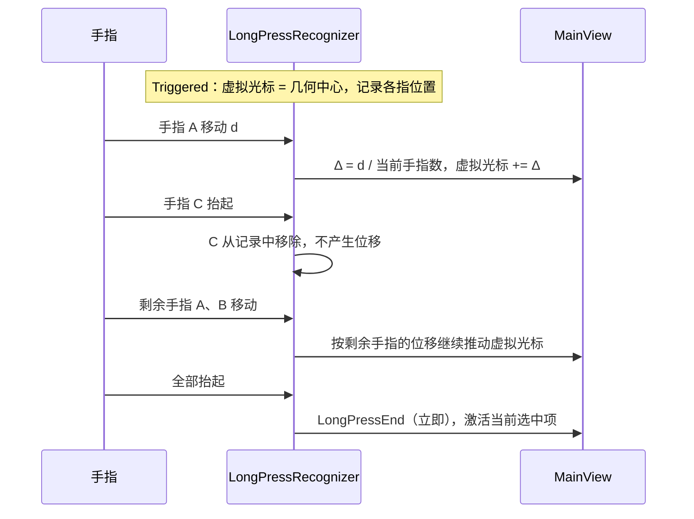

# 切换器选择框：可见度、动画与手势容错

## 概念

- **选择框（focus ring）**：AppSwitcher 中标记当前选中卡片的描边。XAML 的 `FocusBorder`（[/gui/xaml/AppSwitcherRoot.xaml](/gui/xaml/AppSwitcherRoot.xaml#L26-L44)）只作宿主，图形由 [/gui/ui/switcher/MainView.cpp](/gui/ui/switcher/MainView.cpp) 用 Composition `ShapeVisual` 绘制。
- **NaturalMotion 弹簧**：`SpringVector2NaturalMotionAnimation`，运行中被重新 `StartAnimation` 时继承当前速度，连续切换能自然衔接。
- **ExpressionAnimation 绑定**：各几何（白色内圈、强调色宽描边、外沿裁剪）的属性都用表达式绑定到同一个 `CompositionPropertySet`，只对 property set 做动画。
- **生长（Growth）**：长按导航时，强调色的内沿保持不动，外沿朝手指方向加宽，加宽量与累积位移占切换阈值的比例成正比；到达阈值时整框移到下一张卡片，生长清零。
- **虚拟光标（virtual center）**：长按触发时取三指的几何中心作为起点，之后只按各指自身位移的平均值推进，与当前有几根手指无关。

## 架构



| 层 | 职责 |
|----|------|
| `ThreeFingerLongPressRecognizer` | 触发后用各指自身位移的平均值推动虚拟光标，手指增减不产生位移 |
| `ThreeFingerGestureRecognizer` | 长按已触发时不因掉指结束会话，只有全部手指抬起才结束 |
| `MainView::AccumulateAndMoveSelection` | 累积位移；越过阈值则切换并清零该轴；未越过则把累积量映射为生长量 |
| `focusProps_` | `Offset`/`Size` 为强调色外沿静止时的矩形（切换时弹簧动画），`Growth` 为生长量 |
| `FocusBorder` | 宿主元素，ZIndex 11 高于卡片的 10，铺满画布，不参与命中测试；其 `Resources` 存放全部可调参数 |

## 分点解释

### 视觉：留空 + 白色内圈 + 强调色外圈

参照 Win11 Alt+Tab 的做法，从卡片边缘向外依次是：

1. `InflationDip`（6）透明留空：透出后方的亚克力背景，选择框不贴着缩略图。
2. `InnerStrokeDip`（2）白色内圈：`#B3FFFFFF`，即 WinUI 浅色主题的 `ControlFillColorDefault`，深浅两种主题都用这个颜色。
3. `StrokeDip`（4）主题强调色外圈：`UIColorType::Accent`，内沿紧贴白色内圈。

为了让强调色的内沿固定、只让外沿生长，强调色不是画成一条普通描边（普通描边各边等宽），而是由两部分组成：



- 宽描边的宽度足够覆盖最大生长量，它的内沿就是强调色的真实内沿。
- `focusVisual_` 的裁剪几何 `focusClipGeometry_` 决定外沿：静止时外沿距内沿 `StrokeDip`；生长时裁剪矩形在手指方向伸出，露出更多宽描边，所以只有外沿那一侧加宽。
- 白色内圈在裁剪区域内部，不受裁剪影响。

`props.Offset/Size` 是强调色外沿的静止矩形，距卡片边缘 `gap + innerStroke + stroke`。描边几何都取中线：宽描边中线在内沿外侧半个宽描边处，白色内圈中线在强调色内沿内侧半个内圈宽度处。所有圆角都等于卡片圆角（取自 `mainCard.CornerRadius()`）加上该线到卡片边缘的距离，与卡片保持同心。强调色通过 `UISettings::GetColorValue` 获取，失败时回退到 `#0078D4`。每次调用 `MainView::ApplyTheme` 都会执行 `UpdateFocusRingStyle`，主题没变时也会执行，所以运行期间修改系统强调色或动画开关，下次呼出就会生效。

### 动画：入场、切换、布局重算



- **切换**：`SetSelectedIndex` 对 `Offset`、`Size` 启动弹簧（`DampingRatio` 0.85、`Period` 28ms）。相邻两张卡片宽高比不同时，选择框会一边移动一边变形。
- **布局重算**：卡片本身是瞬间移动的，选择框也直接赋值（先 `StopAnimation` 再 `InsertVector2`）。`ShowSwitcher` 一次呼出会跑多次布局，所以会把新目标和上一次的 `focusTargetOffset_`/`focusTargetSize_` 比较，差值在 0.5 DIP 以内就跳过，避免打断入场弹簧。
- **入场**：选择框隐藏时没有上一个位置可以滑过来，所以改为从外扩处淡入并收缩到位。`ResetSelection` 会立即隐藏选择框，保证每次呼出都播放入场动画。
- **拖拽**：`BeginGrab` 和 `ResetInteractionState` 末尾都会调用 `UpdateSelectionVisual`，拖拽期间淡出，松手后重新入场。
- **系统关闭动画时**：`UISettings::AnimationsEnabled()` 为 false 时，所有路径都直接赋值。

### 手势生长

```mermaid
flowchart TD
    A[LongPressMove Δ] --> B[acc += Δ]
    B --> C{|acc| > 阈值?}
    C -- 是 --> D{MoveSelection 成功?}
    D -- 是 --> E[该轴 acc = 0<br/>整框弹簧滑到新卡]
    D -- 否，撞墙 --> F[acc 对阈值取余]
    C -- 否 --> G
    E --> G[Growth = acc/阈值 × GrowMaxDip<br/>该方向无卡片则 × GrowEdgeResistance]
    F --> G
    G --> H{本次发生了切换?}
    H -- 否 --> I[直接赋值，紧跟手指]
    H -- 是 --> J[弹簧收回]
    K[LongPressEnd] --> L[acc 清零，Growth 弹簧收回]
```

- 裁剪几何的表达式：`Offset = props.Offset + (Min(Growth.X,0), Min(Growth.Y,0))`，`Size = props.Size + (|Growth.X|, |Growth.Y|)`。负值向左或向上伸出（移动原点），正值向右或向下伸出（只增加尺寸）。强调色内沿和白色内圈都不受 Growth 影响，所以表现为手指方向那一侧的强调色变宽。
- 阈值沿用原来的规则：当前卡片尺寸加 32 的 0.4 倍。生长量在累积量到达阈值时正好达到 `GrowMaxDip`（5），随后整框移动。用 `LayoutEngine::CalculateNextSelection` 判断该方向是否还有卡片；没有卡片时生长量乘以 `GrowEdgeResistance`（0.3），表现为撞墙时的阻尼。
- 切换成功后该轴的累积量清零，下一次切换需要重新走满一个阈值。撞墙时仍然按阈值取余，生长不会无限累积。

### 输入侧：掉指与依次抬起

旧实现有两个问题：

- **掉指后无法再切换**：长按触发后，只要手指数少于 3 并持续 `fingerDropToleranceMs`（100ms），`HandleActivePhase` 就会以 `QuorumLostTimeout` 结束会话并发出 `LongPressEnd`。会话结束后剩下手指的 `Updated` 事件都被丢弃。手指重新落下会开始一个新会话，需要再按住 400ms，并且会重新呼出切换器、重置选中项。
- **依次抬起导致选择偏移**：位移按「所有当前手指的中心点」逐帧求差。抬起一根手指时，剩余手指的中心会突然跳到另一个位置（约等于手指间距的 1/3，常见在 1cm 以上）。这个跳变被当成一次真实位移，足以越过切换阈值。

修复的思路是改变位移的计算方式：虚拟光标中心不再取手指的几何中心，而是只由每根手指自己的位移来推动。



- **逐指位移推动虚拟光标**（`ConsumeContactDelta`）：识别器记录每根手指上一次的位置。每次更新时，只对前后都存在的手指累加「当前位置 − 上次位置」，再除以当前手指数，作为虚拟光标（`virtualCenter_`）的增量。每个接触事件只有一根手指在动，一帧内多个事件累加起来就是整只手的平均位移。
- **增减手指不移动光标**：抬起的手指从记录中移除，只是不再贡献位移；新落下的手指只登记位置，下一次移动才开始贡献。所以手指数变化本身不会产生任何位移，依次抬起时选择不会偏移。
- **会话不因掉指结束**：[/core/input/gesture/ThreeFingerGestureRecognizer.cpp](/core/input/gesture/ThreeFingerGestureRecognizer.cpp) 的 `HandleActivePhase` 在长按已触发时跳过 `IsFingerDropToleranceExpired` 检查，剩余手指继续导航，会话只在全部手指抬起时通过 `FinalizeSession(AllFingersUp)` 结束，没有额外延迟。长按触发前（识别阶段）的掉指容忍逻辑保持不变。
- **残余风险**：手指抬离屏幕前最后一两帧的滑动仍会被计入。这是真实的手指移动，量级远小于旧实现中的中心跳变。

### 可调参数

选择框参数位于 [/gui/xaml/AppSwitcherRoot.xaml](/gui/xaml/AppSwitcherRoot.xaml#L26-L44) 的 `FocusBorder.Resources`，通过 `MainView::FocusResource` 读取，修改后不需要重新编译。`StrokeDip`、`InnerStrokeDip`、`GrowMaxDip` 决定宽描边的宽度和表达式参数，只在 `CreateFocusRing` 中读取一次，修改后要重启程序才生效。弹簧参数和淡入淡出时长写在 [/gui/ui/switcher/MainView.cpp](/gui/ui/switcher/MainView.cpp) 顶部的匿名命名空间中。

| Key | 默认 | 含义 |
|-----|------|------|
| `InflationDip` | 6 | 卡片边缘到内层描边的留空 |
| `InnerStrokeDip` | 2 | 白色内圈宽度 |
| `StrokeDip` | 4 | 强调色外圈的静止宽度 |
| `EntranceInflationDip` | 8 | 入场动画的起始外扩距离 |
| `GrowMaxDip` | 5 | 累积量到达阈值时的最大生长量 |
| `GrowEdgeResistance` | 0.3 | 该方向没有卡片时的生长比例 |
