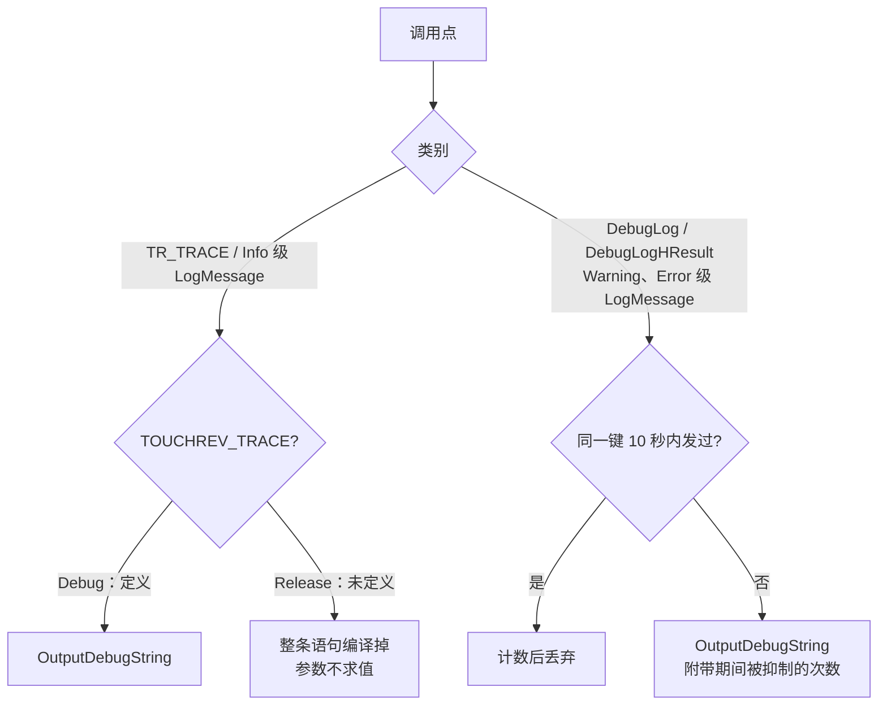

# 日志方案

## 概念

- **追踪日志（trace）**：开发调试用的状态记录，如每次呼出枚举到的窗口、触摸中心坐标、拖动结果。量大、频繁，只对开发者有意义。
- **错误日志（error）**：API 失败、资源加载失败等"不该发生"的情况。平时不出现，出现时才有排查价值。
- **`OutputDebugString`**：把字符串交给调试器或 DbgView 之类的监听者；没有监听者时内容直接丢弃，不落盘，但调用本身和调用前的字符串拼接照常执行。
- **`TOUCHREV_TRACE`**：追踪日志的编译期开关，由根 [CMakeLists.txt](/CMakeLists.txt) 只在 Debug 配置下定义。

## 架构

所有日志都只走 `OutputDebugString`，不写文件，因此不存在磁盘积累。Release 构建通过两种手段把调用压到最少：追踪日志整条编译掉，错误日志限频。

## 分点解释

### GUI 与 core：`Win32Error`

[Win32Error.h](/core/common/Win32Error.h) 提供两类接口：

- `TR_TRACE(流表达式)`，如 `TR_TRACE(L"count=" << count)`。定义了 `TOUCHREV_TRACE` 时展开为 `wostringstream` 拼接后调用 `DebugTrace`；否则展开为空语句，流表达式不会被求值，`wstringstream` 也不会构造。需要循环拼接的大段记录（如枚举窗口列表）直接用 `#if defined(TOUCHREV_TRACE)` 包住。
- `DebugLog` / `DebugLogHResult` 是错误日志，所有构建保留，经 [Win32Error.cpp](/core/common/Win32Error.cpp) 的 `ShouldSend` 限频：以消息内容的哈希为键，10 秒内同一键只放行第一次；再次放行时在行尾附上 `(suppressed N repeats)`。`DebugLogHResult` 先按"上下文 + 错误码"判定，被抑制时连 `FormatMessage` 都不调用。跟踪表最多 64 项，满了淘汰最久未发送的一项，内存占用固定。

状态记录（激活结果、目标显示器、窗口枚举、触摸中心、缩略图挂载、PDB 裁剪、拖动结果）全部改为追踪日志；调试残留（逐次指针事件的 `[DEBUG] ProcessItemPressed/Moved`、拖动代理的 `WM_SIZE` 记录与 `GetTickCount64` 耗时统计）直接删除。启动时 `SetProcessDpiAwarenessContext` 因清单已声明 DPI 感知而返回 `ERROR_ACCESS_DENIED`，属正常情况，不再记录。

输入模块里的 `QueryPerformanceCounter`（[InputController.cpp](/core/input/InputController.cpp#L17)、[RawTouchInput.cpp](/core/input/raw/RawTouchInput.cpp#L36)、[GestureTypes.h](/core/input/gesture/GestureTypes.h#L58)）是手势识别的时间戳，属于功能代码，保留。

### blocker：`LogMessage`

hook DLL（运行在 explorer 中）与注入器共用 [log.cpp](/blocker/common/log.cpp) 的 `LogMessage(component, level, format, ...)`：

- `Info` 级视为追踪日志，未定义 `TOUCHREV_TRACE` 时在格式化之前直接返回；`InitializeLog` 的初始化提示同样只在 Debug 输出。
- `Warning` / `Error` 级按调用点限频：以格式串地址为键（同一调用点的格式串是同一个常量），10 秒内只放行第一次，在格式化之前判定。跟踪表是 64 项的定长数组，由 SRW 锁保护，不分配内存，适合在 explorer 进程里运行。

### 验证

Release 构建启动并呼出、关闭切换器两次，TouchRevGUI 发出的调试输出为 0 条；Debug 构建全部目标（含 hook DLL）编译通过，追踪日志照常输出。
