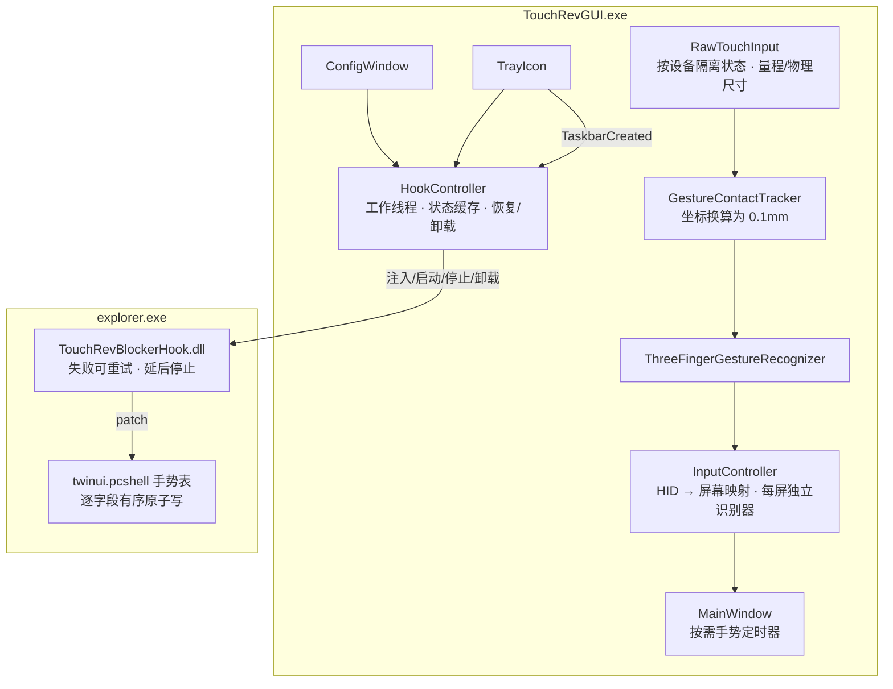
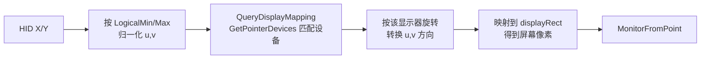
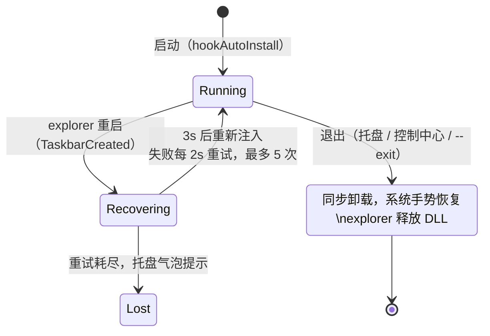
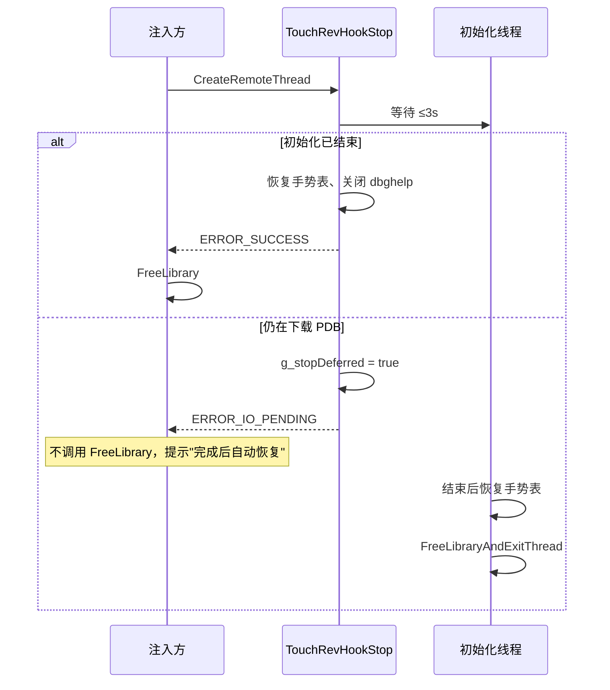

# Touch-Rev 软件问题与修复

## 概念

- **HID 逻辑坐标**：触摸屏通过 Raw Input 上报的 X/Y 是数字化仪自己的逻辑单位（常见量程 0–4095、0–32767 等），和屏幕像素没有固定比例；换算到屏幕坐标或物理距离必须借助 HID 描述符的 LogicalMin/Max、PhysicalMin/Max 与单位，以及指针栈给出的"触摸屏 → 显示器"映射。
- **手势会话（GestureSession）**：从第一根手指落下到全部抬起的一段触摸，识别器在其中判定三指双击 / 三指长按拖动。
- **Hook / Blocker**：注入 explorer.exe 的 `TouchRevBlockerHook.dll`，靠 PDB 符号找到 `twinui.pcshell.dll` 里的手势表 `TouchGestureSettings::s_gestureTargets`，把三指表项改成 0，从而屏蔽 Windows 自带三指手势。
- **延后停止**：Hook 初始化线程仍在下载 PDB 时收到停止请求，DLL 不再让调用方无限等待，而是登记停止，由初始化线程结束后自行恢复手势表并 `FreeLibraryAndExitThread`。

## 架构

GUI 进程仍只有一个 UI 线程，但所有跨进程的 Hook 操作已移到 `HookController` 的工作线程，完成后通过消息回到 UI 线程。Hook 的生命周期由 `HookController` 统一管理：启动策略、explorer 重启恢复、退出卸载都经由它。

问题与修复总览：

| # | 问题 | 严重度 | 修复位置 |
|---|------|--------|----------|
| 1 | HID 原始坐标被当作屏幕坐标，多显示器下切换器出现在错误屏幕、旋转取错 | 🔴 | RawTouchInput / InputController |
| 2 | 手势阈值以"raw × 0.1"为单位，行为随触摸屏分辨率漂移 | 🔴 | RawTouchInput / GestureContact |
| 3 | Hook 生命周期与应用脱钩：退出不卸载、explorer 重启不恢复、两条退出路径不一致 | 🔴 | HookController / main / ConfigWindow |
| 4 | 注入/卸载在 UI 线程同步执行，最长冻结 30 秒以上 | 🟠 | HookController / hook_runtime |
| 5 | 16ms 手势定时器常驻，空闲时也 60Hz 唤醒 | 🟠 | MainWindow |
| 6 | 触点"按下"判定过宽，多块触摸屏共享手指状态，设备拔出不清理 | 🟠 | RawTouchInput / InputController |
| 7 | 一条 WM_INPUT 含多个报告时只保留最后一帧 | 🟡 | RawTouchInput |
| 8 | Hook 状态只看模块是否加载，且每秒对 explorer 做模块快照；失败后无法重试 | 🟠 | HookController / hook_runtime |
| 9 | `--exit` 首实例仍注入、`--toggle` 名不副实、DPI 过滤取错显示器、关闭手势不清状态 | 🟡 | main / MainWindow |
| 10 | 依赖私有接口；手势表 24 字节非原子写 | 🟡 | twinui_gesture_table_patch / ConfigWindow / CardView |

## 分点解释

### 1. HID 坐标到屏幕坐标的映射 🔴

原先 [RawTouchInput.cpp](/core/input/raw/RawTouchInput.cpp) 产出的 HID 坐标被 [InputController.cpp](/core/input/InputController.cpp) 直接放进 `touchCenterScreen`，[MainWindow::ResolveTargetMonitor](/gui/ui/switcher/MainWindow.cpp) 用它调用 `MonitorFromPoint`；单显示器时 `MONITOR_DEFAULTTONEAREST` 掩盖了错误，多显示器时切换器落到错误的屏幕，长按拖动的方向修正也读错显示器的旋转。

现在的链路：

- `RawTouchInput::LoadDeviceGeometry` 在设备首次出现时读取 X/Y 的 `HIDP_VALUE_CAPS`，记录逻辑量程（对被读成负数的满位 LogicalMax 按位宽还原），随 `Frame::geometry` 下发。
- `RawTouchInput::QueryDisplayMapping` 用 `GetPointerDevices` 按设备句柄匹配指针设备，取 `GetPointerDeviceRects` 的显示区域与所属 `HMONITOR`；句柄对不上但只有一块触摸屏时直接采用它，否则退回主显示器。
- `InputController::MapGestureCenterToScreen` 先归一化，再按该显示器的 `dmDisplayOrientation` 旋转（与 `LongPressMoved` 增量旋转同一约定：90° 时 `u' = 1 - v, v' = u`），最后映射到显示区域。长按缓存的旋转也改为取自这块触摸屏所在的显示器。量程无效时不给出触摸中心，`MainWindow` 退回鼠标位置。

### 2. 手势阈值的物理单位 🔴

[GestureContact.cpp](/core/input/gesture/GestureContact.cpp) 原先把 HID 坐标乘 0.1 作为手势坐标，所有阈值（[GestureSessionConfig](/core/input/gesture/GestureSession.h)、[GestureRecognizers.h](/core/input/gesture/GestureRecognizers.h)、`kMaxFingerDistance`）因此随数字化仪分辨率漂移。

现在手势坐标统一为 **0.1mm**：`LoadDeviceGeometry` 从描述符的 PhysicalMin/Max、`Units`（低半字节 1 = cm、3 = inch，长度量纲须为 1）与 `UnitsExp`（4 位有符号）算出物理边长；描述符缺失物理信息时退回 `GetPointerDeviceRects` 的 HIMETRIC 设备矩形；边长不在 20–2000mm 内视为不可信。得到 `tenthMmPerUnitX/Y` 后，`ToGesturePoint` 以 `(raw - LogicalMin) × tenthMmPerUnit` 换算。两路都拿不到物理尺寸时沿用 raw × 0.1。

原阈值的数值没有改：常见数字化仪约 0.01mm/逻辑单位，raw × 0.1 恰好就是 0.1mm，原作者调参所用设备上的行为保持不变，而 30（3mm）、150（15mm）、480（48mm）这些值作为物理距离本身也合理。各阈值旁已注明单位。

### 3. Hook 生命周期 🔴

- **统一退出路径**：控制中心的"退出应用"不再直接 `PostQuitMessage`，而是通过 `ConfigWindow::SetExitCallback` 走 [MainWindow::ExitApplication](/gui/ui/switcher/MainWindow.cpp)，与托盘退出一致，`OnDestroy` 会按序拆除 XAML 与配置窗口。确认框文案改为如实说明"Windows 默认三指手势会恢复"。
- **退出卸载**：[main.cpp](/gui/main.cpp) 在消息循环结束后调用 `HookController::Shutdown(true)`：等待进行中的操作、丢弃未处理的完成消息，再同步卸载 DLL。
- **explorer 重启恢复**：[TrayIcon](/gui/ui/shared/TrayIcon.cpp) 在 `TaskbarCreated` 时除重建图标外调用 `onTaskbarCreated`，`HookController::OnExplorerRestarted` 若用户意图为"开启"（最近一次请求的是启用，或启动时已在拦截），延迟 3 秒后重新注入（新 explorer 需要时间加载 twinui.pcshell），失败时静默重试，重试耗尽才通过托盘气泡提示。

### 4. Hook 操作移出 UI 线程 🟠

[HookController](/gui/hook/HookController.cpp) 用一个工作线程执行原 `ConfigWindow::ToggleHook` 的全部步骤（DLL 存在性、PE 架构、进程架构、查找 explorer、注入/启动/停止/卸载），结果以 `OperationResult` 经消息专用窗口 `PostMessage` 回 UI 线程。同一时间只允许一个操作；进行中时控制中心的开关与"清除缓存"按钮置灰、状态显示"正在处理拦截模块..."，托盘菜单对应项置灰。用户发起的操作在控制中心可见时弹框反馈，其余（启动策略、explorer 恢复、托盘发起）走托盘气泡。启动时的 `ApplyStartupPolicy` 也只是发起后台操作，不再阻塞首个消息循环。

DLL 一侧，[TouchRevHookStop](/blocker/hookdll/hook_runtime.cpp) 对初始化线程最多等待 3 秒：

由谁收尾由 `g_stateMutex` 内的 `g_initializeDone` / `g_stopDeferred` 决定，不会出现双方都卸载或都不卸载；初始化恰好在超时后结束的情况，Stop 会再等初始化线程真正退出，避免注入方 `FreeLibrary` 卸掉仍在执行的代码。[UninstallDllFromProcess](/blocker/injector/inject.cpp) 新增 `unloadDeferred` 输出参数识别这一情况，命令行注入器也会如实输出"stop deferred"。

### 5. 手势定时器按需启停 🟠

[MainWindow](/gui/ui/switcher/MainWindow.cpp) 不再在 `OnCreate` 启动常驻定时器。`UpdateGestureTimer` 在每次处理 `WM_INPUT`、`WM_TIMER`、设备变化后检查 `InputController::NeedsGestureTick()`（即识别器存在进行中的会话）：需要时启动 16ms 定时器，会话结束后立即停止。空闲时进程不再被周期性唤醒。

### 6. 触点状态解析 🟠

- **按下判定**：`ParseSingleContact` 在设备报告 TipSwitch 时只以 TipSwitch 为准，抬起帧 `Tip = 0, Confidence = 1` 会立即产出 Released；设备报告 Confidence 且其为 0（手掌）时不计为手指。设备没有 TipSwitch 时退回 InRange/Confidence，三者都没有时视为按下。各项能力在设备初始化时用 `HidP_GetSpecificButtonCaps` 探测。
- **多设备隔离**：`activeFingers`、`activeFingerIds`、`previousPoints` 以及帧同步计数都挪进 `DeviceContext`。识别器的 contactId 不区分设备，因此 `InputController` 按设备句柄为每块触摸屏各建一个 `DeviceGesture`（识别器、量程、长按旋转缓存），`OnRawInput` 把帧交给所属设备的识别器，`OnGestureTick` 逐个推进有会话的识别器，设备拔出时连同识别器一起移除。两块屏的触点既不会互相覆盖，也不会因一块屏的会话未结束（例如长按中丢失抬起报告）而屏蔽另一块屏——任意屏幕都能随时呼出和操作切换器，与焦点或切换器所在屏幕无关。
- **设备拔出**：`MainWindow` 处理 `WM_INPUT_DEVICE_CHANGE`，`GIDC_REMOVAL` 时 `RawTouchInput::RemoveDevice` 丢弃该设备的预解析数据与状态；若正是当前会话的设备则同时重置识别器。

### 7. 一条 WM_INPUT 的多帧 🟡

`RawTouchInput::ProcessRawInput` 改为返回 `std::vector<Frame>`。`ParseReports` 在中途某个报告完成一帧时立即产出该帧，release-all 报告也不再提前 `return` 丢弃后续报告；`InputController::OnRawInput` 对每帧分别识别，`MainWindow` 依次分发每个结果。[RawTouchInputViewer](/tools/RawTouchInputViewer/RawTouchInputViewer.cpp) 同步改为逐帧处理。

### 8. Hook 状态的准确性与开销 🟠

- **开关语义**：控制中心开关与托盘勾选以 `HookController::IsEffective()` 为准——DLL 已加载且注册表 `PdbStatus` 不是下载失败、`HookStatus` 不在符号/区间/表项/写入失败之列。初始化失败时开关显示为关，用户再打开即可重试；状态文本仍按 `DescribeStatus` 显示具体失败原因。
- **失败可重试**：[TouchRevHookStart](/blocker/hookdll/hook_runtime.cpp) 在 `Failed` 状态下不再返回 `ERROR_INVALID_STATE`，而是关闭旧初始化线程句柄后重新初始化（安装失败时手势表已整体回滚，重试是安全的）。
- **快照开销**：`IsModuleLoaded()` 按 explorer pid 缓存结果，pid 不变时不再做 `TH32CS_SNAPMODULE`；操作完成时用工作线程带回的结果刷新缓存；只有延后卸载尚未完成期间会每次确认。
- **清除缓存**：拦截运行时不再拒绝，而是在工作线程里先卸载、清理、再按原状态重新启用；若 Hook 正在下载符号（停止被延后）则提示稍后再试。

### 9. 启动参数、DPI 与开关的边界 🟡

- **`--exit` 首实例**：没有正在运行的实例时，[main.cpp](/gui/main.cpp) 在创建任何窗口之前直接返回，不再执行启动注入策略。
- **`--toggle`**：首实例启动与唤醒消息中都调用 `MainWindow::ToggleSwitcher()`，切换卡片切换器的显隐；不带参数启动仍打开控制中心。
- **DPI 过滤**：`OnDpiChanged` 改用 `MonitorFromWindow(hwnd_)` 取窗口实际所在显示器的 DPI，不再用鼠标所在屏。
- **关闭手势识别**：`WM_INPUT` 在手势关闭后的第一条消息上调用 `InputController::ResetGesture()` 清掉原始触点与识别器，并停掉定时器；无论开关与否都交给 `DefWindowProc` 做 RIM_INPUT 清理。

### 10. 私有接口降级与手势表写入 🟡

- **手势表写入**：[WriteGestureTableEntry](/blocker/hookdll/twinui_gesture_table_patch.cpp) 不再整条 24 字节赋值，只对 `type`、`fingerCount` 两个 4 字节字段做 `InterlockedExchange`，屏蔽时先清 `type`、恢复时先写 `fingerCount`。explorer 在任意时刻读到的中间态都是 `(0, n)`，不会匹配任何手势，GUID 字段从不改写。
- **透明接口失败**：[ConfigWindow](/gui/ui/config/ConfigWindow.cpp) 记录 `IXamlSourceTransparency` 是否成功；失败时 `UpdateXamlTheme` 给根 Grid 铺主题底色（暗 `#202020` / 亮 `#F3F3F3`），不再露出未定义颜色的不透明位面。
- **缩略图失败**：[SwitcherItem.xaml](/gui/xaml/SwitcherItem.xaml) 中缩略图视觉下方原有的空 TextBlock 命名为 `ThumbnailPlaceholderText`，[CardView](/gui/ui/switcher/CardView.cpp) 在私有缩略图创建失败时显示"窗口预览不可用"，重建时清空。
- 手势表定位仍依赖 PDB 数据符号及相邻符号推算游戏表终点，这一结构性风险无法在代码内消除；现有的区间、表项数校验与失败状态上报保持不变。
